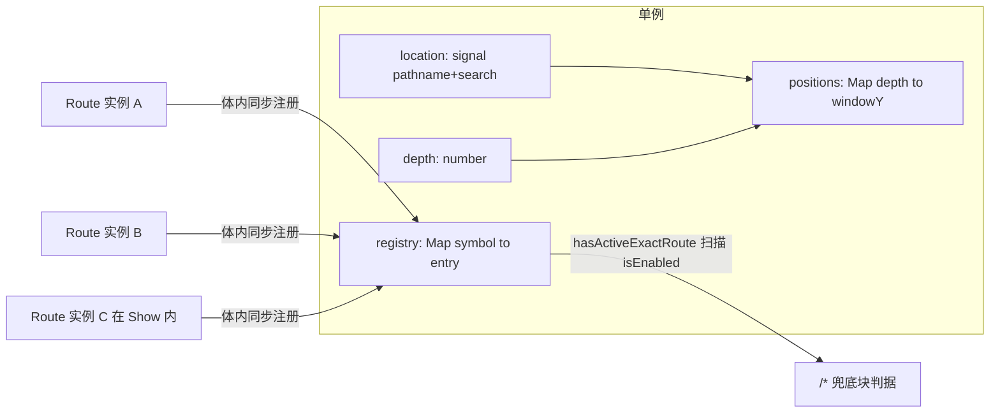
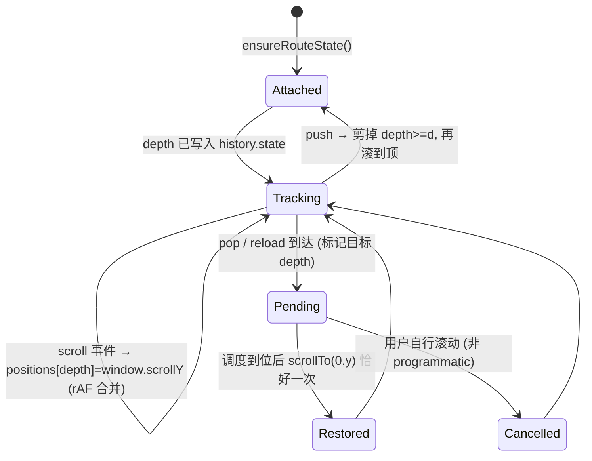

# Static Route + Window Scroll Restoration Design

## Goal

在 `solid-lib` 内用**一个文件** `src/Route.ts` 提供轻量静态路由, 并补上"窗口级进出滚动位置恢复", 同时把 `demo` 从 `@solidjs/router` 切到这套路由。

路由语义刻意保持窄: 静态路径精确匹配, 参数只走 query string, 不引入动态段语法。

## Scope

### In

- `src/Route.ts` 单文件: 匹配, 注册表, 导航, query 参数, 窗口滚动恢复
- `./route` 子路径导出
- `<Route>` 多块同时渲染 (同一 `path` 可有多个实例, 各自在自己的 JSX 位置渲染)
- `demo` 页面组织切到 `<Route>`, 移除 `@solidjs/router`
- 单测 (假 browser port) + 源码契约断言 + demo 构建验证
- README 与本文档

### Out

- 动态段 (`/user/:id`), 通配中间段 (`/a/*/b`), 正则 path, 路由优先级排序
- 嵌套路由 / outlet / 路由级 layout
- loader / action / 数据重校验 / preload / link 状态 (官方 `@solidjs/router` 的数据层)
- SSR 与水合期的 scroll restoration
- 元素级滚动记忆 (`src/useKeepScroll.ts` 已有, 保持独立)
- 首页 redirect 机制

### Anti-goals (即使能跑也算失败)

- 模块顶层副作用 (import 就访问 `window`/`history`/`document`)
- 让没用路由的消费者付出路由体积
- 静默不匹配 (path 写错时毫无反馈)
- 用文本断言替代对滚动状态机的行为测试

## Current Evidence

- 旧模块 `a3a66b0:src/route/` 为 9 文件 771 行, `5f7eb09` 整体删除; 公开面为 `Route` / `pushRoute` / `replaceRoute` / `getRouteBackPath` / `parseParam` / `parseParams`。
- 旧模块多块同时渲染已是既有语义: 每个 `<Route>` 实例在自己位置独立判断 (`Route.tsx` 的 `renderRoute`), 注册表只服务 `/*` 兜底判据 (`state.ts:326-338` 的 `hasActiveExactRoute`, 期间读取 `isEnabled()`, 因此在读取方被 track)。
- 旧模块的浏览器接缝做对了: `state.ts:82` 用 `globalThis` 惰性取 `window`, `state.ts:235` 无浏览器早返回, `state.ts:264-269` 注册与清理成对。
- 反例: `lib/solid/src/Router.tsx:237` 在模块顶层 `createRoot(() => newRoute())`, import 即访问 `window.location` / `history.replaceState` 并挂两个无清理的全局监听; 且 `Router.tsx:71` 使用 `solid-js/web`, 当前 runtime 无此子路径 (实测 `tsc` 报 TS2307)。
- 官方 `@solidjs/router@2.0.0-next.41` 只恢复窗口: 记录 `window.scrollY` (`dist/routers/scrollRestoration.js:81`), 恢复 `window.scrollTo` (`:114`); 全量 `dist/` 无 `scrollTop` (0 命中)。体积实测 (external solid-js/@solidjs/web, min/gzip): 常用面 38.7 KB / 12.5 KB, 全量 108.1 KB / 31.4 KB。
- 本仓库约束: `package.json` 无 `sideEffects` 字段且 `src/_.ts:1` 有 `import "./_.css"`, 因此根入口挂路由会强制所有消费者携带路由体积。
- Node 26 拒绝加载 `.tsx` (即使文件里零 JSX), 可直接加载 `.ts`。
- 设计起点的工作树不干净 (有意为之): `src/Plyr.tsx` / `src/loadScript.ts` / `src/loadStyle.ts` 已删除, 但 `src/_.ts:60,78,79` 仍在导出它们, `src/Swiper.tsx:7` 仍 import `./loadScript`, `test/ui-components.test.ts` 仍有 11 条相关断言; 基线 `node --test` 为 71 tests / 68 pass / 3 fail, demo 构建报 3 个 UNRESOLVED_IMPORT。收尾这套删除与本文档是独立任务, 必须先于路由实现完成以取到全绿基线。

## Contract Decided By Product Owner

1. 单文件组件, 文件名沿用 `Route`。
2. 路径只有静态值, 不使用冒号动态段。
3. 参数只从 query string 读取。
4. 同一 `path` 允许多块同时渲染 (典型 3 块), 包括嵌在 `<Show>` 内的条件块; 不设上限。
5. 滚动只记窗口位置; 容器内部由使用方自行管理。
6. `demo` 切到本路由。

## Decisions Made By Implementer (overridable)

| 决定 | 理由 |
|---|---|
| 文件为 `src/Route.ts`, 不是 `.tsx` | Node 无法加载 `.tsx` (零 JSX 也不行); `.ts` 让滚动状态机可被 `node --test` 直接驱动。旧 `Route.tsx` 本就零 JSX, 用 `createComponent` 渲染 |
| 走 `./route` 子路径, 不挂根入口 | 无 `sideEffects` 声明 + 根入口有 CSS import, 挂根入口无法 tree-shake |
| 保留 `<a href>` 全局拦截与同源校验 | 纯 `<a>` 是 demo 的主要导航形态; 安全校验拒绝跨源 / 协议相对 / 非 http(s) scheme |
| 不设"最多 3 块"上限, 同路径多块不告警 | 3 是用法不是契约 |
| `path` 含 `:` 或含 `*` (除 `/*`) 时 dev 告警 | 动态段不在契约内, 静默不匹配是最贵的一类 bug |
| 滚动 depth 与 back-path 合并进同一 history.state 键 | 一个键一套读写, 避免两个写入者互相覆盖 |
| 兜底块内不得嵌精确路由; 检测到该形态时 dev 告警 | 兜底判据依赖"已挂载的精确路由", 把精确路由放进兜底块会形成注册/卸载振荡 (见下"循环风险") |
| demo 布局改为文档滚动 (body 高度自适应, 顶部固定导航) | 现有 demo 壳 `BottomTab` 是 `overflow:hidden` + `main { overflow-y:auto }`, 窗口不滚, 窗口级恢复不可见 |
| `./route` 直接指向 `src/Route.ts`, 不建 `src/route/_.ts` | `2026-04-13-underscore-entrypoints-design.md` 的约定是"子路径入口用 `_` 命名", 其目的是把聚合入口与实现分离; 单文件没有可聚合的东西, 因此按例外处理。另建 `src/route/_.ts` 会创建 `src/route` 目录并与 `test/flat-source-entry.test.ts:21` 冲突 |
| 无浏览器环境下导航 API 为 no-op + dev 告警, 不抛错 | 导航本质是浏览器动作; 抛错会让 SSG/测试环境里的公共代码无法调用 |

## Runtime Model

### 数据模型

- `registry: Map<symbol, { path, fallback, isEnabled }>`; 条目数是个位数, 判定直接扫描, 不做缓存计数 (缓存需要跟随 `when` 增减, 只会引入失效 bug)。
- 每个实例只做 `normalizePathname(path) === normalizePathname(pathname)` 的字符串比较, 无正则, 无排序。
- `/*` 兜底渲染条件: 当前 pathname 没有任何"已启用且精确匹配"的实例。
- 归一化沿用旧 `match.ts`: percent-decode, 折叠重复 `/`, 去尾 `/` (根除外), 非法 percent 保留原值。

### 循环风险 (必须靠约束而非算法解决)

兜底判据读的是"已挂载"的实例: 若把 `<Route path="/x">` 放进 `/*` 兜底块内部, `/x` 的实例只在兜底块渲染后才存在, 于是判据在"渲染兜底"与"卸载兜底"之间振荡。实现层做两件事: 文档写明该约束, 并在"兜底块处于激活态时又有精确实例注册且匹配当前 pathname"这一签名出现时打 dev 告警。

## Window Scroll Restoration

### 状态机

### 规则

1. 键是 history entry 的 `depth`, 不是 pathname (同一路径可有多条历史记录)。
2. 在 scroll 事件里记录, 不在离开时读取 (阻断/回滚的导航会让"离开时读"记错)。
3. 恢复只做一次, 在目标渲染后的首帧 (`requestAnimationFrame`, 无则 microtask) `scrollTo`。不做 ResizeObserver 追赶式恢复。
4. `programmatic` 标志: 恢复引发的 scroll 不能判为用户接管; 待恢复由真实用户意图 (`wheel` / `touchstart` / `keydown`) 取消, 不由 `scroll` 取消 —— 浏览器自己的历史恢复也会派发 `scroll`。
5. push 时剪掉 `depth >= 新 depth` 的记录并回到顶部; replace 保持 depth 与位置。
6. `pagehide` 把 `positions` 与 `depth` 写入 `sessionStorage`; 首屏绑定 `ensureRouteState` 时仅当 `navigation.type !== "navigate"` (reload / back_forward) 才恢复。
7. 初始化时设 `history.scrollRestoration = "manual"`, 一次性。

### 与元素级滚动的边界

- 本文件只管 `window.scrollY`。
- 容器内部 (可滚动 `<main>` / 列表) 仍由 `src/useKeepScroll.ts` 按 `(pathname, key)` 记忆 `el.scrollTop`。
- 已知限制: 同一 URL 下多个匹配块各自的容器在 pop 后不会被恢复, 除非各块自用 `useKeepScroll`。

## Public API

| 导出 | 形态 | 契约 |
|---|---|---|
| `Route` | 组件 `<Route path component when?>` | `path` / `component` 必须静态; 仅 `when` 可响应式变化; 匹配则在该 JSX 位置渲染 `component()` |
| `pushRoute` | `(path: string) => void` | 同源 http(s) 相对路径; 违规抛错且不写 history |
| `replaceRoute` | `(path: string) => void` | 同上, 替换当前 entry |
| `getRouteBackPath` | `() => string \| null` | 来自当前 entry 元数据, 只返回通过校验的同源内部路径 |
| `parseParam` | `(name, parserOrFallback) => Accessor<T>` | 返回 accessor (`parseParam("page", 1)()`), 与旧 API 一致; 数字 fallback 仅接受 `Number.isFinite` |
| `parseParams` | `(schema) => { [K]: Accessor<T[K]> }` | schema 值为自定义 `(raw: string \| null) => T`; 同一 search 内复用 `URLSearchParams` |
| `ensureRouteState` | `(port?) => cleanup` | 幂等; 无浏览器时早返回; 测试通过 port 注入假实现 |

参数语义: 重复键取首个值, 不支持数组/嵌套; 缺键时 `parseParam` 返回 fallback (自定义 parser 收到 `null`)。

### 组件契约细节

- `component`: 接收**零 props** 的组件; 参数由组件内部调用 `parseParam` 拉取 (拉取式, 不做 props 下发)。
- `when?`: `boolean | (() => boolean)`, 缺省 `true`; 它是唯一允许响应式变化的 prop, 其余两个必须静态。
- 不做隐式异步边界: `component` 若是 `lazy()` 结果, 由使用方在外部用 `<Loading>` 包裹, 本组件不代劳。
- 无 DOM 环境: `<Route>` 恒不渲染, `ensureRouteState()` 早返回, 导航 API no-op + dev 告警。
- `parseParam` / `parseParams` 返回 accessor, 在 JSX 或 memo 里调用 accessor 才会随 location 重算; 两者都会先 `ensureRouteState()`。

### 链接拦截范围

只拦截: 主键、无 `alt/ctrl/meta/shift`、未 `preventDefault`、非 `target=_blank`、非 `download`、`href` 为同源 http(s) 相对路径。`href` 以 `#` 开头的纯锚点交给浏览器。

### back-path 语义

- `pushRoute`: 元数据 backPath = 写入前的内部路径。
- `replaceRoute`: 保留当前 entry 上已有的 backPath。
- pop: 从目标 entry 元数据读取。
- 直接落地 (首屏无元数据): `getRouteBackPath()` 返回 `null`。

## Failure Modes

| 场景 | 行为 |
|---|---|
| `path` 含 `:` / 含非法 `*` | dev 告警, 永不匹配 (不静默等于"随机生效") |
| pathname 非法 percent 编码 | 保留原值参与比较, 不抛错 |
| 恢复目标超过当前文档高度 | 单次 `scrollTo` 后被浏览器 clamp, 保持该值 (与官方取舍一致) |
| pop 期间目标块更晚挂载 | 同上, 属已知限制 |
| 兜底块内含精确路由 | dev 告警 (振荡风险), 设计文档禁止该结构 |
| 跨源 / 协议相对 / `javascript:` 路径 | 抛错, 不写 history, 不改 location |
| `when` 翻转导致精确匹配归零 | 兜底块自动出现 (判据在读取方被 track) |

## Demo Wiring

| 项 | 变更 |
|---|---|
| `demo/src/App.tsx` | 改为"固定顶部导航 + 文档流内容"; 每个页面是 `<Route path="/xxx" component={XxxPage}>`; 路径: `/buttons` `/inputs` `/layout` `/interactive` `/display` `/hooks` `/validate` `/theme` `/tabs`; `/*` 兜底为 NotFound 块 (内部不含精确路由) |
| 多块演示 | 在某条路径上放 2 个无条件块 + 1 个 `<Show>` 条件块, 用作契约的可视验证 |
| `demo/vite.config.ts` | alias 增加 `solid-lib/route` → `../src/Route.ts` |
| `demo/tsconfig.json` | `paths` 已含 `solid-lib/*`, 无需改 |
| demo 全局滚动 | demo 侧覆盖 `body { height: auto }` 以获得文档滚动; **不改** `src/_.css` 与 `BottomTab` |
| `demo/package.json` | 移除 `@solidjs/router`, 同步 `demo/pnpm-lock.yaml` |
| `BottomTab` | 保持现状 (其内部 tab 与元素滚动记忆作为 `/tabs` 页面内容展示), 不改其 API |

## Test Plan

假 port 的最小表面 (测试注入, 生产从 `globalThis` 取): `window` 上的 `addEventListener` / `removeEventListener` / `scrollY` / `scrollTo` / `location` / `history` / `sessionStorage` / `performance.getEntriesByType` / `requestAnimationFrame`。所有断言基于该 port 的调用记录, 不触碰真实 DOM。

单元 (`node --test` + 假 port, 全部可离线):

- 归一化/匹配表: 尾斜杠, 重复斜杠, percent 编码, 非法 percent; 大小写**保持**字面比较
- 多块: 2 无条件 + 1 `<Show>` → 渲染数量 2/3 随翻转; 匹配归零 → 兜底出现 → 翻回 → 兜底消失
- query: 缺键 fallback, `Infinity` / `NaN` 回退, 自定义 parser 收到 `null`, 重复键取首个
- 导航: push 拒绝跨源/协议相对/非 http(s), 违规不写 history
- 滚动: scroll → 记录 → pop → `scrollTo` 恰好一次; programmatic 不取消; 用户意图 (wheel/触摸/键盘) 取消; 目标位置在标记时快照; push 剪枝; replace 不剪枝; `pagehide` → sessionStorage 往返; reload 才恢复 (首次 navigate 不恢复)

契约断言 (源码层面): 模块顶层无 `window` / `history` / `document` 访问; 组件体内 `untrack` 读取静态 props; 注册在组件体内同步写入 (普通 `Map`, 非响应式写), 用 `onCleanup` 注销。

**测试环境事实 (实测, 决定上面的注册时机)**: `node --test` 下 `solid-js` 解析到 `dist/server.js`; 该构建里 signal 读写同步生效, 但 memo 不因写入失效、`createEffect` 的 apply 不执行、`onSettled` 不触发 (用 `createRoot` + `flush` 实测均为 no-op)。因此: (a) 注册放在组件体内同步完成, 否则行为测试永远看不到条目; (b) 单测不依赖调度器, 一律调用读取函数后立即比较, 逻辑层禁止缓存判定结果; (c) 响应式订阅由浏览器构建下的 `isEnabled()` / `readLocation()` 读取保证, 不靠额外版本信号。

集成: `test/demo-build.test.ts` 风格的 demo 构建必须产出 client bundle 且不含 TS 运行时。

## Conflicts To Resolve In Implementation

| 文件 | 现状 | 处理 |
|---|---|---|
| `test/flat-source-entry.test.ts:21` | 断言 `src/route` 目录不存在 | 无需改: 只有 `src/Route.ts` 文件, 不创建该目录 |
| `docs/superpowers/specs/2026-04-13-underscore-entrypoints-design.md` | 子路径入口以 `_` 命名, 且 Out 里写明"不新增 `solid-lib/route` 子路径" | 该文档已被后续实现 (a3a66b0 的 `./route` 导出) 超过; 本文档按上表"例外"处理, 并在该文档追加一行指向本文档 |
| `test/package-metadata.test.ts:15` | exports 键恰好 `[".", "./ui.css"]` | 加入 `./route` 后改为 `[".", "./route", "./ui.css"]` |
| `test/package-metadata.test.ts:71` | demo 必依赖 `@solidjs/router@2.0.0-next.41` | 改为断言该依赖不存在, 并断言 alias 指向本库路由 |
| `test/ui-types.test.ts` | 依赖根入口可 `tsc` | 必须与 `src/_.ts` 的导出保持一致 |
| `docs/superpowers/specs/2026-08-26-solid2-vite-migration-design.md:43` | "路由交给官方 `@solidjs/router`" | 本文档取代该决策; 在该文件对应段落追加一行指向本文档的 supersede 说明, 不删原文 |

## Risks

1. **基线不绿**: 工作树已有 `src/Plyr.tsx` / `src/loadScript.ts` 删除未收尾, 基线 3 个测试失败。必须先决定"先修基线"还是"接受残留失败", 否则无法证明实现没有引入回归。
2. **恢复时机与多块挂载**: 更晚挂载的内容会让恢复值被 clamp; 先用单次恢复并记录, 若出现再评估"一次有界重试"。
3. **demo 布局切换**: 从 `BottomTab` 壳改为文档滚动会影响 demo 观感, 但不改库 CSS; 若视觉回归不可接受, 回退方案是"壳保留 + 另加一条整页路由演示窗口滚动"。
4. **lockfile**: 移除 `@solidjs/router` 需同步 `demo/pnpm-lock.yaml`; 工作树已有未提交的 lockfile 改动, 需避免混入。
5. **拦截范围**: 全局 click 委托会影响 demo 内所有 `<a>`; 只处理主键无修饰单点击且非 `target=_blank` / `download`。

## Open Items (TODO 与还债条件)

- `TODO(scroll-ssr)`: 不做 auto/manual 交还浏览器的水合路径。还债条件: 引入 SSR 或开始使用 `@solidjs/start`。
- `TODO(scroll-retry)`: 单次恢复在内容晚挂载时会被 clamp。还债条件: demo 或真实消费者出现可复现的"返回后位置偏上"。
- `TODO(param-array)`: 不支持重复键数组与嵌套参数。还债条件: 出现需要 `?tag=a&tag=b` 的页面。

## Rollback

实现完成后若不满意: 删除 `src/Route.ts`, 还原 `package.json` 的 `exports`, 还原 demo 三个文件 (`App.tsx` / `vite.config.ts` / `package.json`) 与 lockfile, 还原上表四处测试断言。库内其他组件不受影响 (本设计不修改任何现有组件)。
